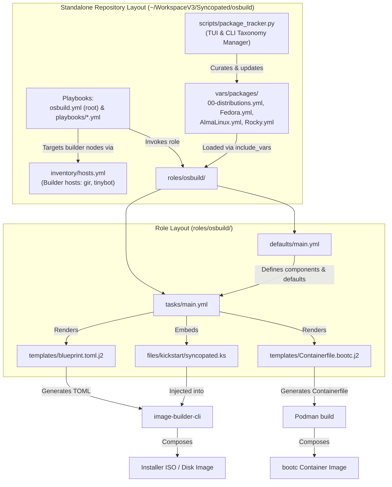

This page provides a **structural overview** of the `osbuild` Ansible role, explaining the purpose, relationships, and key implementation details of its directories and files. It is designed for developers who need to **navigate, modify, or extend** the role with confidence.

Understanding the repository structure is foundational for all subsequent tasks, from customizing blueprints to debugging build failures. This document avoids implementation details that belong to other pages (e.g., blueprint syntax, kickstart logic) and instead focuses on **how the pieces fit together**.

---

## 1. High-Level Repository Architecture

The `osbuild` project is organized as a **dedicated standalone repository** (`~/WorkspaceV3/Syncopated/osbuild`) that houses both the root build environment and the encapsulated `osbuild` role located in `roles/osbuild/`. The repository architecture follows a **modular, component-driven design** combining top-level playbooks, an interactive package taxonomy management tool, and Ansible role conventions for image composition.

The structure is optimized for:
- **Separation of concerns**: Playbooks orchestrate builds, `scripts/package_tracker.py` maintains taxonomy, `vars/packages/` holds canonical package mappings, and `roles/osbuild/` implements blueprint generation and build execution.
- **Extensibility**: New distributions, package mappings, components, or build modes can be added without refactoring existing playbooks.
- **Standalone autonomy**: The repository includes its own `ansible.cfg`, `inventory/hosts.yml` targeting builder nodes (`gir`, `tinybot`), and package taxonomy definitions independent of external collections.

Below is a **Mermaid diagram** illustrating the end-to-end repository architecture and role execution flow:



**Key Insight**:
The repository provides a complete build workflow: developers and automation can use `scripts/package_tracker.py` to inspect or update package taxonomy in `vars/packages/`, execute root `osbuild.yml` or specialized playbooks in `playbooks/`, and leverage `roles/osbuild/` to drive either traditional ISO image builds or modern `bootc` container images via a unified variable interface (`osbuild_build_bootc`).

Sources: [osbuild.yml](../../../osbuild.yml), [tasks/main.yml](tasks/main.yml#L1-L68), [defaults/main.yml](defaults/main.yml#L20-L80), [docs/ARCHITECTURAL_REVIEW.md](docs/ARCHITECTURAL_REVIEW.md#L45-L60)

---

## 2. Directory Structure Breakdown

The repository consists of two tiers: the **standalone repository root** and the encapsulated **role layout** within `roles/osbuild/`.

### 2.1 Standalone Repository Layout (`~/WorkspaceV3/Syncopated/osbuild`)

| Path / Directory | Purpose | Key Files | Description |
|------------------|---------|-----------|-------------|
| **`osbuild.yml`** | Root playbook | `osbuild.yml` | Primary entry point for composing custom workstation images on builder hosts. |
| **`ansible.cfg`** | Configuration | `ansible.cfg` | Configures role paths (`./roles`), default inventory, and execution settings. |
| **`inventory/`** | Host inventory | `hosts.yml` | Defines builder hosts (`gir`, `tinybot`) grouped under `builder` and `osbuild_targets`. |
| **`playbooks/`** | Specialized playbooks | `osbuild-rocky-iso-nvidia.yml`, `osbuild-almalinux-iso.yml`, `osbuild-rocky-cuda-container.yml`, `osbuild.yml` | Pre-configured playbook variants for target distributions, container builds, and interactive builds. |
| **`roles/osbuild/`** | Core Ansible role | `defaults/`, `tasks/`, `templates/`, `files/`, `vars/`, `meta/`, `tests/` | Encapsulated role implementing blueprint generation, repository configuration, and image building. |
| **`scripts/`** | Management tooling | `package_tracker.py` | Python-based TUI and CLI tool for taxonomy maintenance, package lookup, and generating build manifests. |
| **`vars/packages/`** | Package taxonomy | `00-distributions.yml`, `Fedora.yml`, `AlmaLinux.yml`, `Rocky.yml` | Canonical source of truth for distribution packages, categories, and cross-distribution mappings. |
| **`build-selections/`**| Build manifests | Exported YAML / JSON / TOML files | Saved component selection manifests generated by `package_tracker.py`. |
| **`.agents/`** | AI agent skills | `skills/syncopated/SKILL.md` | Syncopated appliance builder agent skill documentation and prompt context. |

### 2.2 Role Layout (`roles/osbuild/`)

| Directory | Purpose | Key Files | Relationship to Repository |
|-----------|---------|-----------|---------------------------|
| **`defaults/`** | Default variable definitions. Acts as role **source of truth** for defaults. | `main.yml` | Consumed by `tasks/`, `templates/`, and `vars/`. Overridden by playbooks in `playbooks/` or root `osbuild.yml`. |
| **`tasks/`** | Ansible task files orchestrating the build lifecycle. | `main.yml`, `blueprint.yml`, `build.yml`, `bootc.yml`, `select_build_mode.yml` | Loads canonical taxonomy from `../../vars/packages/` and distribution variables from `vars/`. Renders templates. |
| **`templates/`** | Jinja2 templates for blueprint and build script generation. | `blueprint.toml.j2`, `Containerfile.bootc.j2`, `kickstart.toml.j2`, `disk.toml.j2` | Rendered by `tasks/blueprint.yml` and `tasks/bootc.yml`. |
| **`files/`** | Static assets embedded into images. | `kickstart/syncopated.ks`, `firstboot/syncopated-firstboot`, `almalinux/10/`, `fedora/43/` | Referenced by blueprints and kickstart templates during build composition. |
| **`vars/`** | Role repository & GPG definitions for build hosts. | `AlmaLinux.yml`, `Fedora.yml`, `Rocky.yml` | Loaded dynamically based on host distribution to supply image-builder package sources. |
| **`meta/`** | Role metadata for Ansible Galaxy. | `main.yml` | Defines role dependencies, platforms, and author info. |
| **`handlers/`** | Event-driven tasks. | `main.yml` | Service notification handlers. |
| **`tests/`** | Validation and testing logic. | `validate_schema.py`, `kickstart.bats`, `firstboot.bats`, `validate_build_modes.yml` | Validates component schema and task resolution. |
| **`docs/`** | Architectural and migration documentation. | `ARCHITECTURAL_REVIEW.md`, `MIGRATION_LOG.md` | Explains design decisions, migration history, and upgrade paths. |

Sources: [Directory Structure](#), [meta/main.yml](meta/main.yml#L1-L33), [scripts/package_tracker.py](../../../scripts/package_tracker.py)

---

## 3. Key Files Explained

### 3.1 `defaults/main.yml`
**Purpose**: Defines **global default variables** for the role, including build configuration, blueprint metadata, and compatibility flags.

**Key Variables**:
- `osbuild_distro`: Target distribution (e.g., `fedora-43`, `almalinux-10.2`).
- `osbuild_arch`: CPU architecture (`x86_64`, `aarch64`).
- `osbuild_components`: List of components to include (e.g., `gnome`, `nvidia`, `cuda`).
- `osbuild_build_bootc`: Boolean flag to enable `bootc` container image mode.
- `osbuild_only_generate`: If `true`, generates build scripts without executing them.

**Architectural Insight**:
This file uses **backward-compatibility variables** (e.g., `osbuild_image_type`) to support legacy playbooks while encouraging migration to `image-builder-cli` types. It also defines **conditional defaults** based on the build host’s distribution.

Sources: [defaults/main.yml](defaults/main.yml#L1-L80)

---

### 3.2 `tasks/main.yml`
**Purpose**: **Entry point** for the role. Orchestrates the build process by including sub-tasks based on build mode.

**Key Logic**:
1. **Validation**: Checks for required variables and OS compatibility.
2. **Mode Selection**: Uses `select_build_mode.yml` to determine whether to build a traditional ISO or `bootc` container.
3. **Task Inclusion**: Dynamically includes `blueprint.yml`, `build.yml`, or `bootc.yml` based on mode.

**Example Flow**:
```yaml
- name: Select build mode
  ansible.builtin.include_tasks: select_build_mode.yml
  tags: ["osbuild"]
```

**Architectural Insight**:
The role uses **task inclusion** rather than conditional execution to improve readability and maintainability. Each sub-task is self-contained and testable.

Sources: [tasks/main.yml](tasks/main.yml#L1-L50), [tasks/select_build_mode.yml](tasks/select_build_mode.yml)

---

### 3.3 `templates/blueprint.toml.j2`
**Purpose**: Jinja2 template for generating **blueprint files** in TOML format, which define the content and customizations of the image.

**Key Sections**:
- **Metadata**: `name`, `description`, `version`, `distro`.
- **Package Groups**: Dynamically populated from `osbuild_components`.
- **Packages**: Individual packages from component definitions.
- **Customizations**: User accounts, kernel arguments, services, and filesystem layout.

**Dynamic Generation**:
The template iterates over `osbuild_components` and pulls package lists and groups from `osbuild_component_defs` (defined in `defaults/main.yml`).

**Example**:
```toml



[[packages]]
name = "{{ package }}"



```

Sources: [templates/blueprint.toml.j2](templates/blueprint.toml.j2#L1-L30), [defaults/main.yml](defaults/main.yml#L100-L200)

---

### 3.4 `files/kickstart/syncopated.ks`
**Purpose**: **Kickstart file** for automated installation. Embedded into blueprints via `[customizations.installer.kickstart]`.

**Key Features**:
- **Dynamic Disk Selection**: Uses `%pre` scripts to select the largest NVMe disk.
- **Partitioning**: Configurable via `osbuild_kickstart_*` variables.
- **Firstboot Disabled**: Uses `firstboot --disable` to defer post-install tasks to `firstboot` scripts.

**Architectural Insight**:
The kickstart file is **static but parameterized** via environment variables set by the role. This avoids Jinja2 templating in kickstart files, which can conflict with TOML syntax.

Sources: [files/kickstart/syncopated.ks](files/kickstart/syncopated.ks#L1-L30), [tasks/blueprint.yml](tasks/blueprint.yml#L50-L80)

---

### 3.5 `vars/AlmaLinux.yml` (and Similar)
**Purpose**: **Distribution-specific variables**, including repository configurations and GPG keys.

**Key Structure**:
- **Repository Definitions**: Metalinks, base URLs, and GPG key paths.
- **GPG Strategy**: Prefers `file://` URLs for bundled keys and `https://` for remote keys.

**Example**:
```yaml
repo:
  almalinux-baseos:
    metalink: "https://mirrors.almalinux.org/metalink?repo=baseos-{{ _distro_version }}&arch={{ osbuild_arch }}"
    gpgkey_url: "file:///usr/share/distribution-gpg-keys/alma/RPM-GPG-KEY-AlmaLinux-{{ _distro_major_version }}"
    check_gpg: true
```

**Architectural Insight**:
Variables are loaded dynamically using `ansible.builtin.include_vars` based on `osbuild_distro`. This allows the role to support multiple distributions without conditional logic in tasks.

Sources: [vars/AlmaLinux.yml](vars/AlmaLinux.yml#L1-L30), [tasks/repo_keys.yml](tasks/repo_keys.yml)

---

### 3.6 `tests/validate_schema.py`
**Purpose**: **Schema validation** for component definitions in `defaults/main.yml`.

**Key Features**:
- Validates required fields (`label`, `packages`, `blueprint_groups`, etc.).
- Allows Jinja2 expressions in list fields (e.g., `{{ osbuild_nvidia_packages }}`).
- Outputs a summary of all components and their validity.

**Architectural Insight**:
This script ensures that component definitions adhere to the expected schema before the role is executed, preventing runtime errors.

Sources: [tests/validate_schema.py](tests/validate_schema.py#L1-L30), [defaults/main.yml](defaults/main.yml#L100-L200)

---

## 4. Relationships Between Key Files

The following table summarizes the **data flow** between key files:

| Source File | Produces/Consumes | Target File | Purpose |
|-----------|------------------|------------|--------|
| `defaults/main.yml` | Defines | `osbuild_components`, `osbuild_distro` | Global configuration |
| `defaults/main.yml` | Defines | `osbuild_component_defs` | Component metadata |
| `tasks/main.yml` | Includes | `tasks/blueprint.yml` | Blueprint generation |
| `tasks/blueprint.yml` | Renders | `templates/blueprint.toml.j2` | Generates TOML blueprint |
| `templates/blueprint.toml.j2` | Embeds | `files/kickstart/syncopated.ks` | Kickstart automation |
| `tasks/build.yml` | Executes | `image-builder-cli` | Builds ISO image |
| `vars/AlmaLinux.yml` | Extends | `defaults/main.yml` | Distribution-specific repos |
| `tests/validate_schema.py` | Validates | `defaults/main.yml` | Schema compliance |

---

## 5. Next Steps

Now that you understand the repository structure, you can explore deeper topics:

- **[Default Variables and Overrides in `defaults/main.yml`](9-default-variables-and-overrides-in-defaults-main-yml)**: Learn how to customize the role for your use case.
- **[Understanding Blueprints: Definition and Customization](6-understanding-blueprints-definition-and-customization)**: Dive into blueprint syntax and component selection.
- **[Build Modes: Selecting and Configuring for Your Use Case](8-build-modes-selecting-and-configuring-for-your-use-case)**: Compare traditional ISO and `bootc` container modes.
- **[Testing Framework: BATS and Python Tests](20-testing-framework-bats-and-python-tests)**: Learn how to validate your changes.